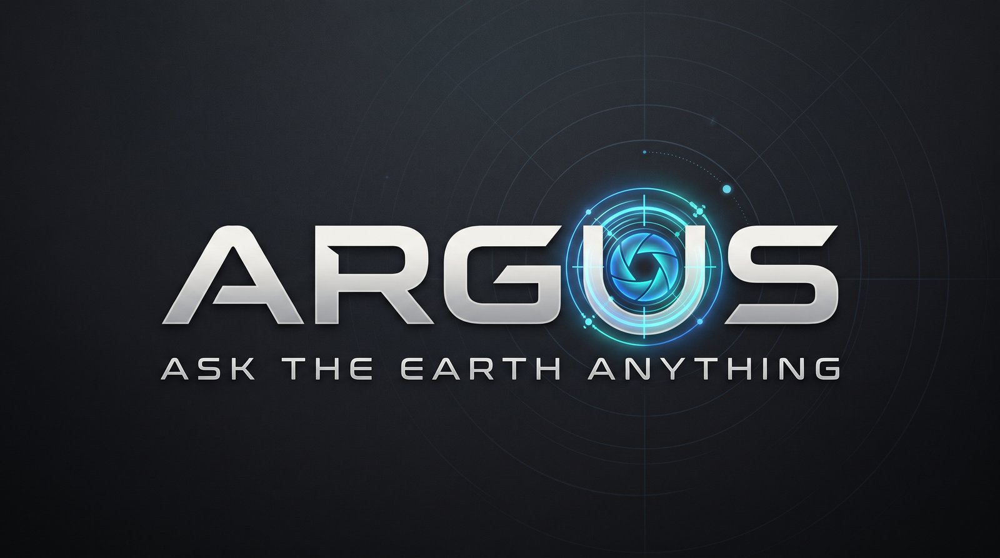
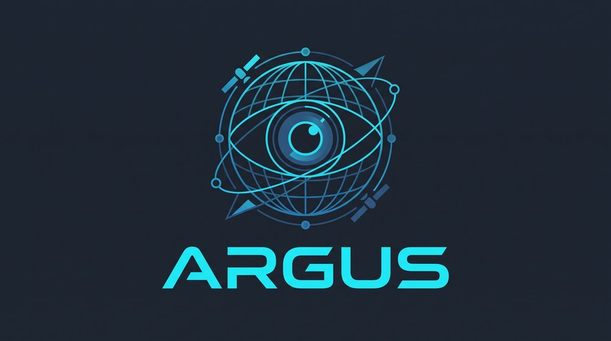

<!-- prettier-ignore -->
<div align="center">
  
  <h1>ARGUS</h1>
  <p><em>An autonomous analyst that watches the planet from orbit.</em></p>

  [](https://github.com/techafreshh/argus/actions/workflows/ci.yml)
  [](https://www.python.org)
  [](https://fastapi.tiangolo.com)
  [](https://react.dev)
  [](https://dev.meta.ai)
  [](LICENSE)

  [Overview](#overview) · [Architecture](#architecture) · [The eyes](#the-eyes) · [Tech stack](#tech-stack) · [Quickstart](#quickstart) · [Configuration](#configuration) · [Eval gate](#eval-gate) · [Deploy](#deploy) · [API](#api-surface)
</div>

---

ARGUS takes a watchlist — regions plus plain-English questions — and runs an unprompted loop:
**plan → acquire → analyze → verify → alert**. It plans its own satellite data acquisitions,
pulls climate feeds, segments and detects change, cross-checks independent sources, and files
graded intelligence reports with confidence scores. Alerts queue for human approval; every
claim carries receipts; every prediction lands in a hit/miss ledger.

And it **remembers you** — conversations, watch definitions, and approval decisions persist
across sessions (long-term memory via Mem0; gracefully no-ops without a key, or offline).

> [!IMPORTANT]
> **Meta Global AI Developer Hackathon submission — live at [argus.techa.pro](https://argus.techa.pro) through Nov 8.**

## Overview

ARGUS replaces dashboard-watching with an agent that measures the Earth itself. Four
principles are enforced by construction, not by prompting:

- **Measure, don't trust headlines.** Phase claims come from ARGUS' own computed index,
  validated against official records before they ship.
- **Precision over recall.** Ambiguity surfaces as an ambiguity card, never as a hedged alert.
  A missed event logged honestly beats a false alarm.
- **Receipts for everything.** Every tool call is logged with source, parameters, data hash,
  rendered evidence and token usage. Claims are audit trails, not assertions.
- **Never fabricate.** Questions outside the catalog get an honest missing-data statement
  naming what would be needed — the question router makes this unavoidable.

## Architecture

<div align="center">
  <a href="docs/architecture.png">
    
  </a>
</div>

> [!TIP]
> The diagram is fully explorable. **Zoom & pan it in [`docs/architecture.html`](docs/architecture.html)** —
> scroll to zoom, drag to pan, double-click to reset (pinch works on touch). Served locally with:
>
> ```sh
> python -m http.server 8080 --directory docs
> # → http://localhost:8080/architecture.html
> ```
>
> The editable source lives in [`docs/architecture.excalidraw`](docs/architecture.excalidraw).

The summary flow: APScheduler fires a watch → the **Muse Spark** planner emits a typed JSON
`Plan {sensor, aoi, window, comparison}` against a tool registry → typed adapters acquire
data (tile cache, retries, SAR fallback under cloud) → analysis (NDVI/NDWI, bi-temporal
change, SAM 3.1 segmentation) → cross-source verification gates alerting at ≥85 % confidence
with multi-source evidence, otherwise an ambiguity card → graded report + queued alert →
hit/miss ledger. SQLite (WAL) stores watches, acquisitions, receipts, alerts, predictions
and model spend. State-changing actions are gated behind a GitHub sign-in when `ARGUS_GITHUB_*`
keys are armed — reads stay open.

## The eyes

Both eyes run on the same spine — a second eye proves the design generalizes.

- **El Vigía — ENSO watchman.** Computes the Niño3.4 Oceanic Niño Index itself from NOAA
  OISST (never taking headlines at face value), validates against NOAA CPC's official table,
  classifies phase and trajectory, finds the closest historical year with a fully explainable
  kNN over ~500 monthly ocean states ("≈2015 @ 91 %"), reconfigures its sub-watchers by
  phase, and live-checks analog expectations against CHIRPS rainfall — divergence is signal.
- **Fireline — fire regimes.** 20-year MODIS burned-area baselines per region, anomaly as
  percentile vs baseline, FIRMS active-fire correlation, community-path warnings drafted to
  the approval queue.

<div align="center">
  
</div>

## Tech stack

| Layer | Choice | Notes |
|---|---|---|
| Language | Python 3.12 | single language for the product runtime |
| API | FastAPI + APScheduler | in-process standing watch (60 s tick), `httpx` adapters |
| LLM | **Meta Model API** (`api.meta.ai/v1`) | OpenAI-compatible; **Muse Spark 1.3** plans and interprets, **SAM 3.1** does concept-prompt segmentation; spend-capped against the credit budget |
| Storage | SQLite (WAL) | watches, acquisitions, receipts, alerts, predictions, meta_spend |
| Memory | **Mem0 Platform** (hosted) | long-term chat memory — ARGUS remembers you: conversations, watch definitions and approval decisions survive sessions; empty key = graceful no-op, offline never egresses |
| Frontend | Vite + React 19 + MapLibre GL v5 + **beUI** | dark ops room: globe, watchlists, approvals, receipts; static bundle served by FastAPI — no Node runtime deployed |
| Agent ↔ UI bridge | **CopilotKit** over the **AG-UI protocol** | the chat dock streams plan steps, tool calls and receipts; panels work over plain REST without it |
| Agent ↔ Earth bridge | typed adapter protocol | 16 typed data adapters behind one `fetch(spec) → TypedResult` interface, tile caching, fixtures/offline mode |
| Build | **pi coding agent SDK** (build-time only) | executed the implementation briefs; the shipped product never depends on it at runtime |
| Deploy | Docker + Compose | single `api` service serving API + control room + scheduler; offline demo mode flag |

## Quickstart

```sh
# backend + control room (static bundle ships in-repo)
pip install -e .[test]
export META_API_KEY=...            # or write .env — see Configuration
python -m uvicorn argus.server.app:app --host 0.0.0.0 --port 8000
curl -sf http://localhost:8000/healthz     # → {"ok": true}
```

> [!TIP]
> No Meta API key? Run `ARGUS_OFFLINE=1` — the whole demo replays from `fixtures/`
> with zero network egress.

```sh
# web control room (only needed when hacking on the UI)
cd web && npm install && npm run dev     # dev server
npm run build                            # → argus/server/static (served by FastAPI)
```

Tests and lint (same gate CI runs):

```sh
pytest -q
ruff check .
```

## Configuration

All secrets live in untracked `.env` (see [`.env.example`](.env.example)); keys are never
logged and never rendered in receipts.

| Variable | Purpose |
|---|---|
| `PORT` | HTTP bind port (default `8000`) |
| `META_API_KEY` | Meta Model API key (`api.meta.ai/v1`); empty = offline/no-op planner |
| `ARGUS_OFFLINE` | `1` = fixtures-only mode, no egress |
| `ARGUS_DB_PATH` | SQLite path (default `data/argus.db`) |
| `MEM0_API_KEY` / `MEM0_USER_ID` | Long-term chat memory via Mem0; empty = disabled |
| `ARGUS_PUBLIC_URL` | Public base URL used in delivered report links |
| `ARGUS_GITHUB_CLIENT_ID` / `_SECRET` | Arm the GitHub sign-in gate for pipeline actions |
| `ARGUS_SESSION_SECRET` / `ARGUS_GITHUB_ADMINS` | Session signing; optional login allowlist |

## Eval gate

ARGUS ships with hard gates — correctness against ground truth, not vibes:

| Gate | Bar |
|---|---|
| ONI probe | own-ONI vs NOAA official — correlation ≥ 0.99, phase agreement ≥ 95 % over the 40-year series |
| Replay probes | 1997 / 2015 / 2023 ENSO, Punjab 2022 heat, Red Sea 2023-24 reproduce known outcomes from cached archives |
| False-positive probes | cloud, seasonal burn, SAR lookalike → abstain or < 85 % confidence, never alert |
| Novel-question probes | out-of-catalog questions → honest missing-data receipt — zero fabrication |

Run them: `pytest -q` for probe suites, or issue `POST /api/eval/run` on a live deployment
and watch [/spend-eval](https://argus.techa.pro/spend-eval).

## Deploy

Single service on Docker — the `api` container serves the HTTP API, the static control room
and the in-process scheduler:

```sh
cp .env.example .env   # fill in secrets
docker compose up --build -d
curl -sf "http://localhost:${PORT:-8000}/healthz"
```

Full details (VPS layout, offline demo mode, health checks) in [`docs/deploy.md`](docs/deploy.md).

## API surface

Base URL `/api` · JSON · reads are open, writes gated by GitHub sign-in when armed.

<details>
<summary>Endpoints</summary>

| Method | Path | Purpose |
|---|---|---|
| GET/POST | `/watches` | List / create watch (region + question + cadence) |
| DELETE | `/watches/{id}` | Remove watch |
| POST | `/watches/{id}/run` | Trigger the loop manually |
| GET | `/watches/{id}/receipts` | Receipt trail for a watch |
| GET | `/alerts` | Alert feed (queued + decided) |
| POST | `/alerts/{id}/approve` · `/reject` | Approval decision |
| GET | `/reports/{id}` | Graded report (figures, confidence, sources) |
| POST | `/ask` | Question router → pipeline run or honest missing-data receipt |
| GET | `/enso/status` | Own ONI, NOAA comparison, phase, top-3 analogs, sub-watchers |
| POST/GET | `/channels` | Webhook alert channels (Slack, Discord, Telegram, n8n) |
| GET | `/spend` | Meta credit spend, per-call breakdown |
| POST/GET | `/eval/run` · `/eval/status` | Eval-gate probes + results |
| GET | `/healthz` | Liveness |

</details>

<details>
<summary>Question templates (router catalog)</summary>

Flooding (NDWI + rainfall + news) · Vegetation decline (NDVI z-score) · Fire anomaly
(FIRMS + burned area) · Drought development (CHIRPS percentile + NDVI) · Ship / surface-object
presence (SAR + SAM) · Reservoir / water change (NDWI) · Dust risk (aerosol + wind).
Anything outside the catalog gets an honest missing-data receipt — that's the design.

</details>

## Data sources

All free, all cited in every report:

NOAA OISST v2.1 · CHIRPS v2 · NASA FIRMS · MODIS MCD64A1 · Sentinel-2 L2A · Sentinel-1 ·
Sentinel-5P · VIIRS night lights · ERA5 · Open-Meteo · GDELT 2.0 · OSM Overpass ·
Wikidata · NOAA CPC ONI table (validation snapshot)

---

*At runtime ARGUS runs on the Meta Model API: **Muse Spark** plans and interprets,
**SAM 3.1** is the eyes.*

*"A hundred eyes. One brief. Ask the Earth anything."*
